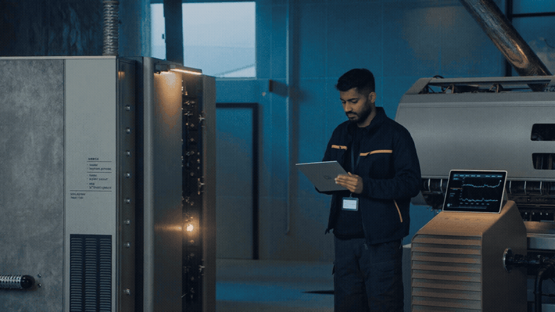
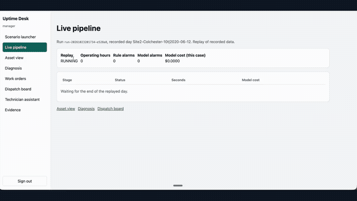

# Uptime Desk

Uptime Desk turns recorded HVAC sensor faults into cited work orders, waits for a manager, and assigns a qualified technician.

[Try the permanent recorded demo](https://uptime-desk.vercel.app) | [Open the cinematic showcase](https://abh2050.github.io/hvac-ai-service-desk/) | [Read the gate evidence](reports/)

[](https://abh2050.github.io/hvac-ai-service-desk/)

> The public demo replays API responses captured from one live AWS run. It needs no sign-in or backend, so it remains available after the demo stacks are removed.

## The 30-second version

A service manager selects a recorded LBNL fault day. Uptime Desk replays its sensor rows through Kinesis, scores each operating window with deterministic rules and an XGBoost model, and opens a case only when the evidence clears policy checks. Bedrock proposes a diagnosis from equipment manuals. A second model and a literal page check verify every quotation. PostgreSQL refuses any unverified work-order step. The manager can approve, edit, or reject the draft. OR-Tools then assigns a technician who has the right certification, shift, site access, and SLA window. A technician assistant answers questions about that technician's own jobs through MCP.

The design keeps code in charge of identity, citations, approval, and dispatch constraints. The model proposes content inside those boundaries.


## What the demo shows

1. A manager launches a replay of recorded building sensor data.
2. The console shows rule alarms, model alarms, and their disagreement.
3. A diagnosis page links each accepted quotation to its manual and page.
4. The case machine pauses until the manager approves, edits, or rejects the draft.
5. OR-Tools assigns a qualified technician and records a runner-up and reason.
6. The technician assistant reads only the signed-in technician's jobs and verified manual passages.

The hosted end-to-end batch passed 8 of 10 runs. The 2 blocked runs had no sourced lockout step, so they never reached approval. This is a measured Gate 5 result from [reports/gate-5.json](reports/gate-5.json).

## Scene, before, and after

At 5:40 a.m., an illustrative facilities service manager stands beside an air handler while the building is still quiet. A supply-air trend has started to drift, but the alarm does not name the failed part or the safe service steps. The manager has to compare a trend, a manual, and a dispatch sheet before a qualified technician can move.

Before Uptime Desk, the evidence stops at each handoff. The trend does not carry a manual page. A plausible diagnosis can contain an unsupported step. The nearest technician can still lack the required certification, site access, shift coverage, or time before the service window closes.

With Uptime Desk, the recorded episode keeps its source rows. Rules and XGBoost show their disagreement. Bedrock proposes a diagnosis from retrieved manual pages, and a second model verifies each quotation. PostgreSQL accepts only verified work-order steps. The manager approves, edits, or rejects the draft. OR-Tools then produces a policy-compliant dispatch, and the identity-bound assistant exposes only assigned work.

[](https://abh2050.github.io/hvac-ai-service-desk/#walkthrough)

The scenario above is illustrative. The evaluation uses recorded public LBNL data, not a live customer building.

## Result categories

Every result in this repository belongs to one of these categories.

| Category | Meaning |
|---|---|
| **Ground truth** | Published LBNL fault labels. |
| **Measured** | Detection, diagnosis, citation, latency, cost, security, and computed optimizer results produced by the gate runs. |
| **Not validated** | Downtime avoided, field visits saved, and dollar savings. Uptime Desk claims none of them. |

Lab, field, and simulated results stay separate. Dispatch results come from a scenario model over recorded cases. They are not field savings.

## Scorecards

### Gate 1: detection

The detector was measured against published LBNL ground-truth labels. Rules remain the primary detector because they win on the lab economizer and the field RTU. A disagreement between rules and the model goes to manager review.

| Test slice | XGBoost recall | Rules recall | Result |
|---|---:|---:|---|
| Lab AHU | **0.957** | 0.739 | Model wins |
| Lab economizer | 0.958 | **1.000** | Rules win |
| Field RTU | 0.187 | **0.648** | Rules win |

False alarms ranged from 0.5 to 1.9 events per unfaulted operating day. Source: measured results in [reports/gate-1.json](reports/gate-1.json).

### Gate 2: diagnosis and citation checks

Run 3 scored 92 cases. The AI result is compared with a keyword baseline for verified fault type, a rule hint for the proposed type, and keyword retrieval for citation support.

| Measured result | AI | Baseline |
|---|---:|---:|
| Verified fault type | **0.293** | 0.043 |
| Proposed fault type | **0.424** | 0.326 |
| Citation support | **0.880** | 0.122 |

The proposal difference was not statistically significant, with an exact McNemar p value of 0.078. On 60 unused field days, the frozen pipeline reached 0.750 verified fault-type accuracy and 0.915 citation support. Those days came from the same 2 field episodes, so they are not an episode-level holdout. Sources: measured results in [reports/gate-2.json](reports/gate-2.json), [reports/gate-2-stats.json](reports/gate-2-stats.json), and [reports/gate-2-holdout.json](reports/gate-2-holdout.json).

### Gate 3: work orders and dispatch

These are scenario model results for 37 jobs. The optimizer and both baselines used the same certifications, shifts, access rules, travel assumption, and SLA windows.

| Scenario method | Total lateness | Late jobs | Travel | Constraint violations |
|---|---:|---:|---:|---:|
| OR-Tools | **402 min** | **4** | 974 min | 0 |
| Nearest qualified | 1,343 min | 10 | **853 min** | 0 |
| Earliest available | **402 min** | **4** | 1,268 min | 0 |

Earliest available tied OR-Tools on lateness. Nearest qualified won on travel. OR-Tools produced the lowest weighted cost, and all 10 policy tests passed. Source: measured scenario results in [reports/gate-3.json](reports/gate-3.json).

### Gate 4: technician assistant

| Measured result | Value |
|---|---:|
| Written-question accuracy | 27 of 30, or 0.900 |
| Manual citation support | 28 of 29, or 0.966 |
| Adversarial tests | 12 of 12 |
| Unauthorized reads | 0 |
| Latency | p50 4.12 s, p95 9.05 s |
| Model cost | $0.00097 per question |

The weak slice was mixed questions, where only 1 of 3 passed because the model sometimes skipped a required job lookup. Source: measured results in [reports/gate-4.json](reports/gate-4.json).

### Gate 5: hosted system

| Measured result | Value |
|---|---:|
| Full flow | 8 of 10 runs passed |
| Replay start to work-order draft | median 39.4 s |
| Replay start to dispatch | median 77.3 s |
| Model cost per incident | average $0.00206 |
| Cross-technician data leaks | 0 |

Both failed runs were blocked because the case had no sourced lockout step. The average model cost covers diagnosis and entailment calls. Per-incident infrastructure cost was not isolated. Source: measured results in [reports/gate-5.json](reports/gate-5.json).

## System design

The AWS deployment runs in `us-east-2`. The always-on foundation holds the API, Cognito, Aurora Serverless v2, the Bedrock Knowledge Base, AgentCore Gateway, S3, and CloudWatch. The demo profile adds Kinesis, the replay and case state machines, detection workers, and the Fargate dispatch task. The VPC has no NAT gateway. Four interface endpoints and one S3 gateway endpoint carry private service traffic.

The permanent Vercel demo is a separate static build from GitHub `main`. It serves captured responses from `app/static-demo/snapshot/` and never calls the AWS backend.

### Context and runtime flow

| System context | Sensor replay |
|---|---|
| [](diagrams/system-context.svg) | [](diagrams/replay-sequence.svg) |
| Case state machine | Fault policy flow |
| [](diagrams/case-state-machine.svg) | [](diagrams/fault-flow.svg) |

### Retrieval, access, and assistant calls

| Manual retrieval and verification | Identity and access |
|---|---|
| [](diagrams/knowledge-base.svg) | [](diagrams/security.svg) |
| MCP request sequence | Data model |
| [](diagrams/mcp-sequence.svg) | [](diagrams/data-model.svg) |

### Infrastructure and operations

| Full AWS architecture | Network |
|---|---|
| [](diagrams/aws-architecture.svg) | [](diagrams/network.svg) |
| Deployment and cost profiles | Observability |
| [](diagrams/deployment.svg) | [](diagrams/observability.svg) |

All 12 diagrams come from [diagrams/build_diagrams.py](diagrams/build_diagrams.py). The repository keeps the draw.io source plus PNG and SVG exports.

## Safety and access controls

- API Gateway validates a Cognito JWT on every API route except CORS preflight.
- The AgentCore Gateway interceptor discards caller-supplied identity and inserts claims from the verified token.
- Each Lambda has its own IAM role scoped to named resources.
- A technician can read only assigned work orders and history for their assets.
- Every denied request enters `audit_log` and emits a CloudWatch metric.
- Each manual quotation must pass a literal page match and a second-model entailment check.
- `work_order_steps.verified` has a database check constraint, so unverified steps cannot be stored.
- The case machine blocks approval when no sourced lockout or disconnect step exists.
- A manager remains the only actor who can approve, edit, or reject a draft.

## Data and models

The project uses 123 Release 1 episodes from public LBNL datasets: 119 lab episodes and 4 field files from 2 Connecticut sites. Another 27 simulated files remain held for Release 2. Raw source files stay out of git. [data/SOURCES.md](data/SOURCES.md) records URLs, licenses, checksums, label conflicts, and manual compatibility.

| Task | Implementation |
|---|---|
| Detection | Deterministic HVAC rules plus local XGBoost |
| Diagnosis | `openai.gpt-oss-120b-1:0` on Amazon Bedrock |
| Entailment | `openai.gpt-oss-20b-1:0` on Amazon Bedrock |
| Retrieval | Bedrock Knowledge Bases, Titan Text Embeddings v2, S3 Vectors |
| Dispatch | OR-Tools CP-SAT in an ECS Fargate task |
| Assistant tools | MCP handlers behind AgentCore Gateway |
| Web console | React, TypeScript, Vite, and Amplify UI |
| Infrastructure | AWS CDK in TypeScript |

The manuals cover equipment classes, not the exact LBNL units. Every Release 1 diagnosis therefore carries a compatibility warning.

## Run it yourself

### Public demo

Open [uptime-desk.vercel.app](https://uptime-desk.vercel.app). Choose any recorded run from the left rail. The demo contains the trend, diagnosis, citations, work order, dispatch result, assistant exchange, and evidence pages from one captured live run.

### Static demo locally

Use Node.js and npm. The build reads only committed snapshot files and gate reports.

```bash
cd app
npm ci
cd ..
scripts/build-static-demo.sh
cd app
npx vite preview --host 127.0.0.1 --port 4174 --outDir ../build/vercel/uptime-desk
```

In another shell, run the static smoke test.

```bash
cd app
BASE=http://127.0.0.1:4174 node e2e/static-smoke.mjs
```

### Python tests

The Python code requires Python 3.12. The database tests use PostgreSQL on port 54329. Tests that need raw or processed evaluation data require the files listed in [data/SOURCES.md](data/SOURCES.md).

```bash
uv sync
docker run --name uptime-pg \
  -e POSTGRES_PASSWORD=localtest \
  -e POSTGRES_DB=uptime \
  -p 54329:5432 \
  -d postgres:16
.venv/bin/python -m pytest -q tests
```

If the container already exists, start it with `docker start uptime-pg`.

### Frontend and infrastructure checks

```bash
cd app
npm ci
npm run lint
npm run build

cd ../infra
npm ci
npm run build
npx cdk synth --profile awsnew
npx cdk diff --profile awsnew
```

The CDK stacks target `us-east-2`. Review every diff before a deploy. The profile scripts in `scripts/` prompt before changing cloud resources. Do not run `scripts/demo-down.sh` while the hiring-manager demo week is active.

### Rebuild diagrams

```bash
python3 diagrams/build_diagrams.py
scripts/export-diagrams.sh
```

The export script requires the draw.io desktop CLI on `PATH`.

## Copilot Studio plan

Release 3 would expose selected API operations to a Microsoft Copilot Studio agent through a custom connector. The connector, its OAuth flow, and the agent have not been built. [docs/copilot.md](docs/copilot.md) records the proposed operations, identity boundary, and acceptance tests.

## Limitations

1. **Building operations faults go undetected by the diagnosis step.** The lab RTU.csv data has 11 operations fault cases, such as lighting schedule errors, setback errors, and infiltration. The AI proposed an equipment fault for all 11 and identified 0 of them (`reports/gate-2.json`, run 3, `operations_routing`). The pipeline still routes an operations proposal to operations review when no equipment rule fired. It never dispatches a technician for one.
2. **No manual covers the coil valves of the lab air handlers.** The public manual set has no hot water or chilled water coil valve service manual. The added Honeywell document covers the valve actuator only. Lab AHU diagnoses therefore abstain on 82.6% of cases and produce 0 verified answers (`reports/gate-2.json`, run 3, `by_family`).
3. **No manual matches any unit exactly.** LBNL does not name the makers of the AHUs or the field RTUs. Every manual is a class match, so every diagnosis carries "compatibility uncertain" (`data/SOURCES.md`).
4. **The AI's lead over the rule hint is not statistically significant.** In naming the fault, the AI scored 0.424 (95% CI 0.328 to 0.526) and the rule hint 0.326 (0.239 to 0.427). That gives 15 against 6 discordant cases and an exact McNemar p of 0.078 (`reports/gate-2-stats.json`). The AI's lead in verified diagnoses over the keyword baseline is significant (0.293 against 0.043, p < 0.0001).
5. **The diagnosis prompt was chosen after seeing test results.** Run 3 was selected after runs 1 and 2 were scored on the same cases. Every lab episode was used in those runs, so no lab holdout exists. The frozen run 3 pipeline was scored once on 60 unused days of the 2 field episodes (`reports/gate-2-holdout.json`). These are unused days, not unused episodes.
6. **Field data is small.** The field set has 2 faulted episodes, one per site. Field results rest on those 2 units.
7. **Detection raises too many false alarms for unattended use.** Gate 1 measured 0.5 to 1.9 alarm events per unfaulted operating day (`reports/gate-1.json`).
8. **The travel model is simple.** Dispatch uses straight-line distance at 40 km/h from each technician's home base, with no road network.

## What I would build next

- Add exact equipment manuals and coil-valve service documents, then rerun diagnosis on a new episode-level holdout.
- Train a separate router for building operations faults before any equipment diagnosis or technician dispatch.
- Add road travel times and live technician location constraints to dispatch evaluation.
- Improve mixed assistant questions so the agent always resolves the user's job before searching manuals.
- Complete the planned Copilot Studio connector and test user-delegated identity end to end.

## Repository map

| Path | Purpose |
|---|---|
| `app/` | React console, Amplify auth, Playwright tests, static demo snapshot |
| `services/` | API, detection, diagnosis, citation checks, MCP tools, assistant |
| `pipelines/` | Data preparation, training, evaluation, deploy helpers |
| `infra/` | CDK stacks for foundation and demo profiles |
| `config/` | Sites, technicians, rules, policies, dispatch weights |
| `reports/` | Human and machine-readable gate evidence |
| `diagrams/` | Generated draw.io, PNG, and SVG architecture set |
| `docs/` | Showcase, source notes, and Release 3 plan |

## Builder

Built by [Abhishek Shah](https://abh2050.github.io/abhishek-shah-portfolio/). Source: [github.com/abh2050/hvac-ai-service-desk](https://github.com/abh2050/hvac-ai-service-desk).
