<p align="center">
  <a href="https://abh2050.github.io/hvac-ai-service-desk/#video">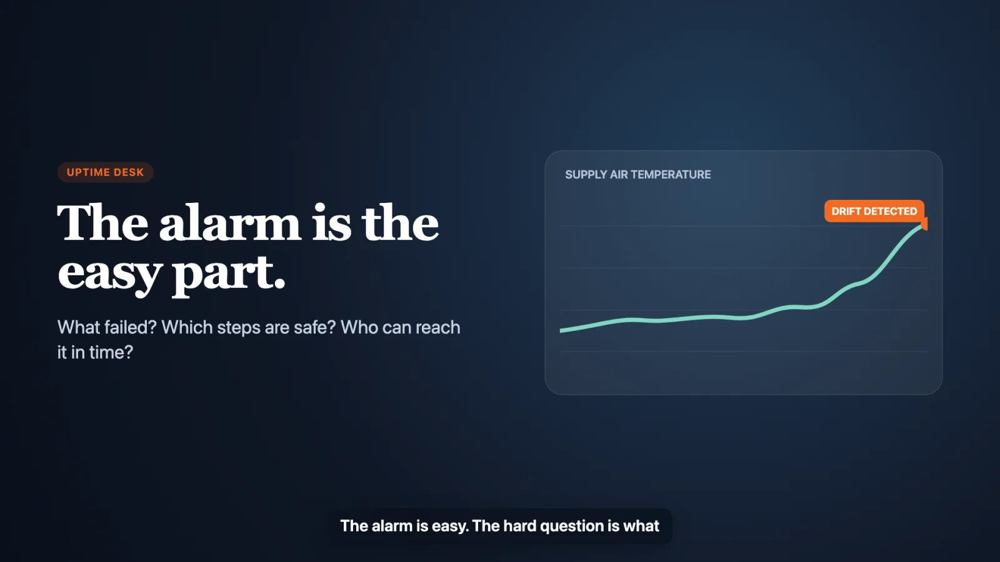</a>
</p>

# Uptime Desk

**An AI service desk for HVAC maintenance, built on AWS.** When an air handler or rooftop unit starts to fail, Uptime Desk turns the sensor alarm into a diagnosis that quotes the equipment manual, a work order that a manager approves, and a qualified technician on the way. Code checks every quote, approval, and assignment.

**[Watch the 2.5-minute video](https://abh2050.github.io/hvac-ai-service-desk/#video)** · **[Open the recorded demo](https://uptime-desk.vercel.app)** · **[Visit the project page](https://abh2050.github.io/hvac-ai-service-desk/)** · **[Read the gate reports](reports/)**

| Replay to drafted work order | Replay to dispatched technician | Model cost per incident | Unauthorized reads |
|:---:|:---:|:---:|:---:|
| **39.4 s** median | **77.3 s** median | **$0.0021** average | **0** in 12 adversarial tests |

<sub>Measured on the hosted AWS system (reports/gate-5.json, reports/gate-4.json). The recorded demo needs no sign-in: it replays real API responses captured from one live run, so it stays up after the AWS stacks are removed.</sub>

## The problem

A building automation system can tell a service manager that a supply air temperature is drifting. It cannot answer the three questions that decide how fast the building recovers:

1. **What failed?** Someone still has to work out which component failed, and whether the equipment or the building schedule caused it.
2. **Which steps are safe?** Service and lockout steps live in manufacturer PDFs that the alarm system never reads.
3. **Who can get there in time?** The nearest technician may lack the certification, the shift, the site badge, or the escort clearance, while the SLA clock runs.

## How it works, in five steps

1. **Detect.** Recorded sensor data replays through Kinesis. Deterministic rules decide whether an hour is faulty, and an XGBoost model gives a second opinion. A disagreement goes to a manager.
2. **Diagnose with the manuals.** A model on Amazon Bedrock proposes the likely fault, the Knowledge Base returns matching manual pages, and the model quotes them with the page number.
3. **Verify every quote.** Each quote must appear on its cited page, and a second model must judge that the page supports it. The database refuses any step that fails, and an order without a sourced lockout step is blocked.
4. **Approve, then dispatch.** Step Functions pauses until the manager approves, edits, or rejects. Approval starts an OR-Tools solve on Fargate that respects certifications, shifts, site access, escorts, and SLAs.
5. **Technicians ask over MCP.** Technicians ask about their own jobs through AgentCore Gateway. Identity comes from the sign-in token, so a request for another technician's job is denied and audited.

Models propose. Deterministic code decides. The manager approves every order that reaches a technician.

### Who uses it and what it touches

[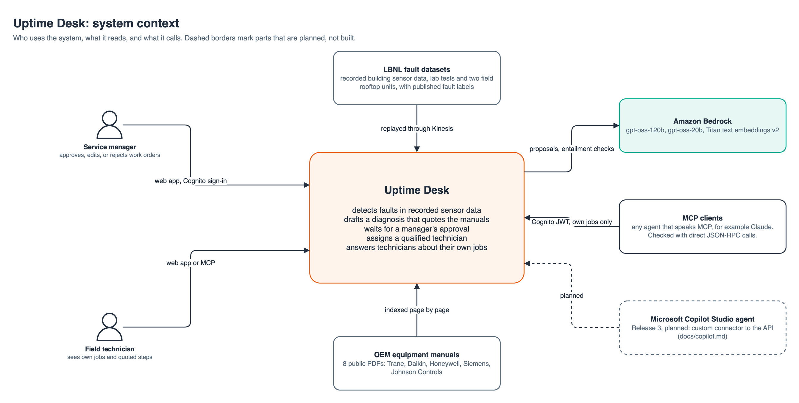](diagrams/system-context.svg)

### How one fault becomes one work order

Every white diamond is a decision made by code, and P1 to P10 are the decision policies tested in Gate 3. The orange box is the only human decision.

[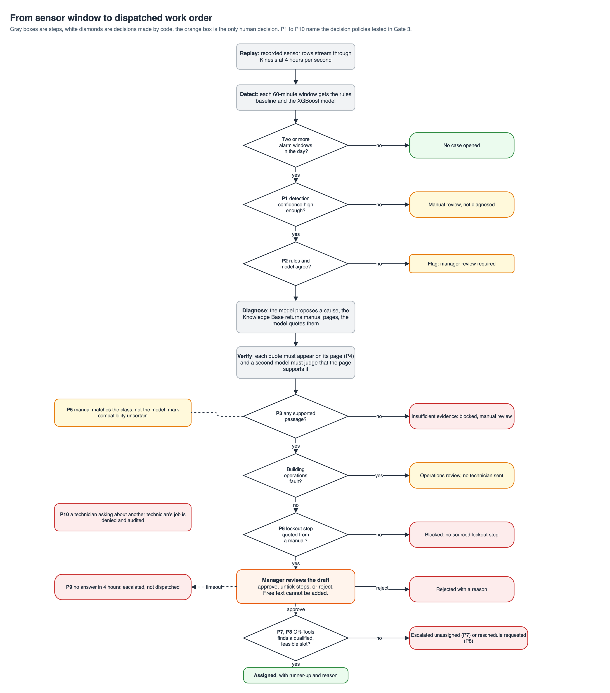](diagrams/fault-flow.svg)

## Results at a glance

Each gate compared the AI path against a simple baseline on recorded LBNL data. The baseline wins stay in the table.

| Gate | What was tested | AI path | Baseline | Winner |
|---|---|---:|---:|---|
| 1 | Detection recall, lab air handlers | **0.957** | 0.739 rules | AI |
| 1 | Detection recall, field rooftop units | 0.187 | **0.648** rules | Baseline |
| 2 | Citation support, 92 cases | **0.880** | 0.122 keyword | AI |
| 2 | Fault type, 60 held-out field days | **0.750** | 0.133 keyword | AI |
| 3 | Total lateness, 37-job scenario | **402 min** | 1,343 nearest qualified; 402 earliest available | Tie with one baseline |
| 4 | Assistant answers correct | **27 / 30** | none | 12 of 12 adversarial tests passed |
| 5 | Hosted end-to-end runs | **8 / 10** | none | 2 blocked: no sourced lockout step |

| Category | Meaning |
|---|---|
| **Ground truth** | Published LBNL fault labels. |
| **Measured** | Detection, diagnosis, citation, latency, cost, security, and computed optimizer results produced by the gate runs. |
| **Not validated** | Downtime avoided, field visits saved, and dollar savings. Uptime Desk claims none of them. |

Lab, field, and simulated results stay separate. Dispatch results come from a scenario model over recorded cases, not from field operations.

## Architecture on AWS

Everything runs in `us-east-2` and is defined in AWS CDK (TypeScript). The always-on profile holds data, identity, and the API. The demo profile adds the streaming pipeline and the Fargate solver only while a demo runs. Orange badges follow one incident from sign-in to dispatch.

[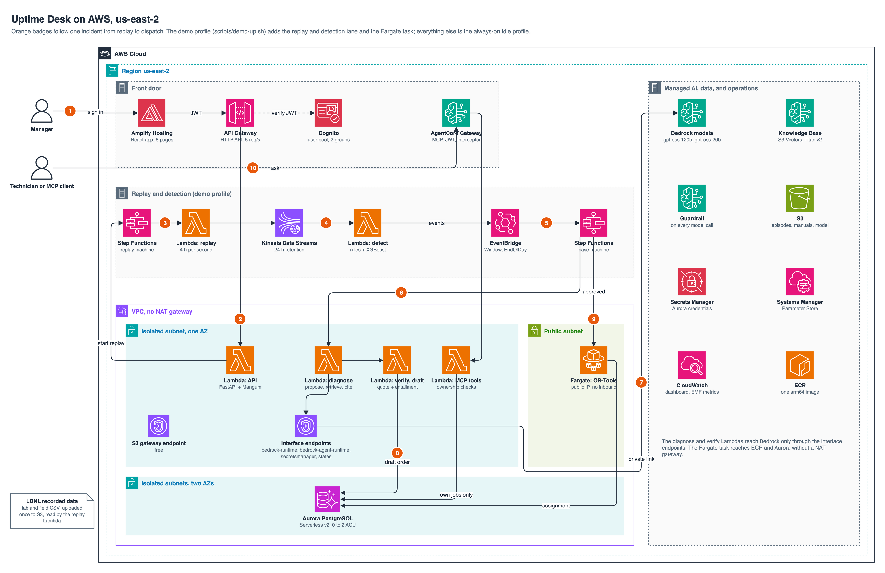](diagrams/aws-architecture.svg)

| Layer | AWS services |
|---|---|
| Ingest and detect | Kinesis Data Streams, Lambda (arm64 container images), EventBridge |
| Orchestrate | Step Functions with a task-token approval wait, ECS Fargate running OR-Tools CP-SAT |
| Reason | Amazon Bedrock (gpt-oss-120b, gpt-oss-20b), Knowledge Bases on S3 Vectors with Titan Text Embeddings v2, Bedrock Guardrails |
| Store | Aurora PostgreSQL Serverless v2 (auto-pause), S3, Secrets Manager, Systems Manager Parameter Store |
| Access | Cognito, API Gateway HTTP API with JWT authorizer, AgentCore Gateway (MCP) with a request interceptor |
| Network | VPC with no NAT gateway, four interface endpoints, an S3 gateway endpoint |
| Deliver and operate | AWS CDK, Amplify Gen 2, CloudWatch dashboard with embedded metrics |

## AWS deep dive

Each diagram below opens as an SVG. The draw.io sources and the generator, [diagrams/build_diagrams.py](diagrams/build_diagrams.py), live in [diagrams/](diagrams/).

### 1. Event-driven replay

A replay starts with one API call. Step Functions drives the replay Lambda, which writes four recorded hours per second to Kinesis. The detect Lambda emits an EventBridge event per hour and one at the end of the day, which starts the case machine.

[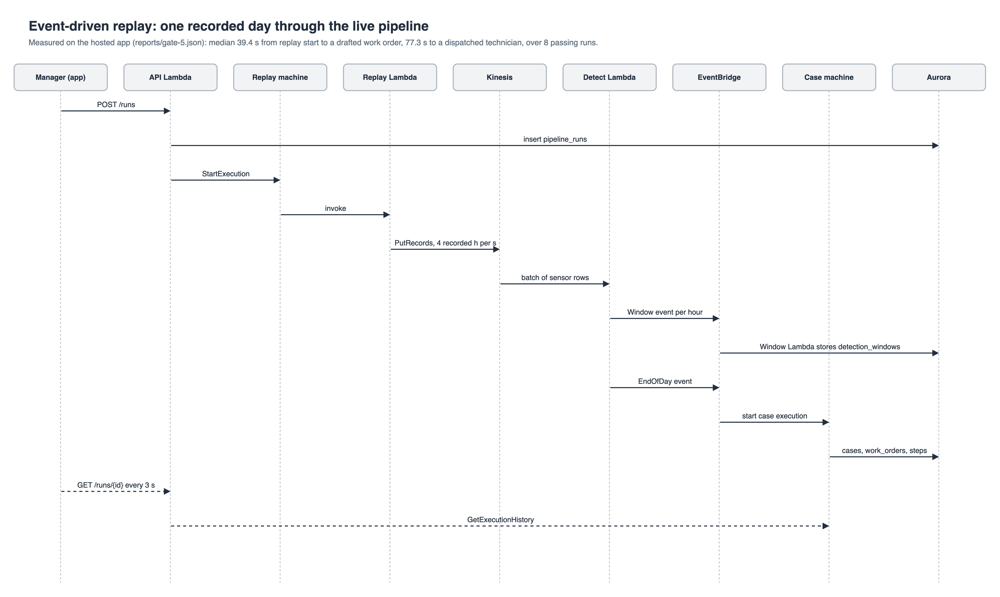](diagrams/replay-sequence.svg)

### 2. The Step Functions case machine

Each Lambda task returns facts, and Choice states route on them. The approval wait stores a task token in Aurora. The API resumes the execution with SendTaskSuccess or SendTaskFailure, and a 4-hour timeout escalates the order instead of dispatching it.

[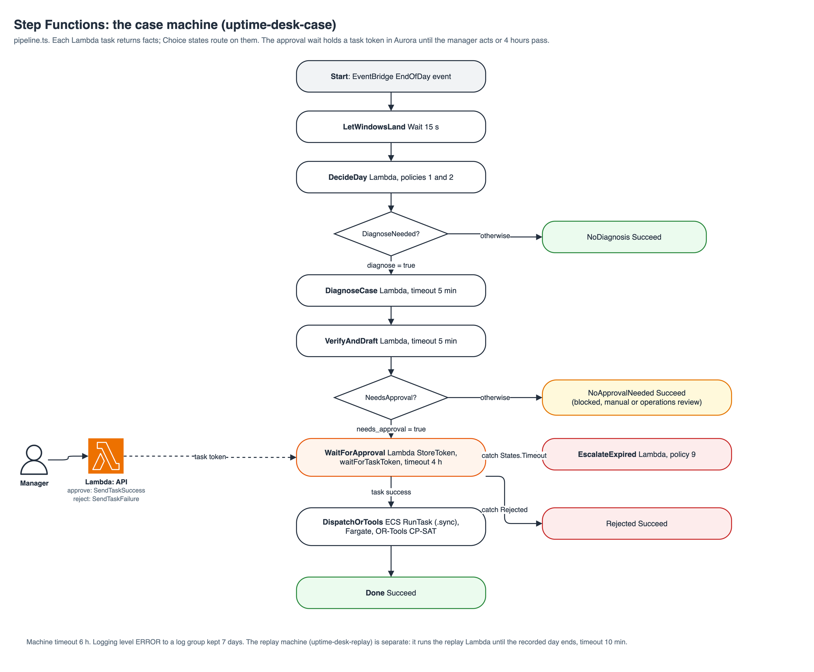](diagrams/case-state-machine.svg)

### 3. Manual retrieval and citation checks

Each manual page is one Knowledge Base document, with its manual and page in metadata. Retrieval filters by equipment class. A quote reaches a work order only after a literal page match and an entailment check by a second model.

[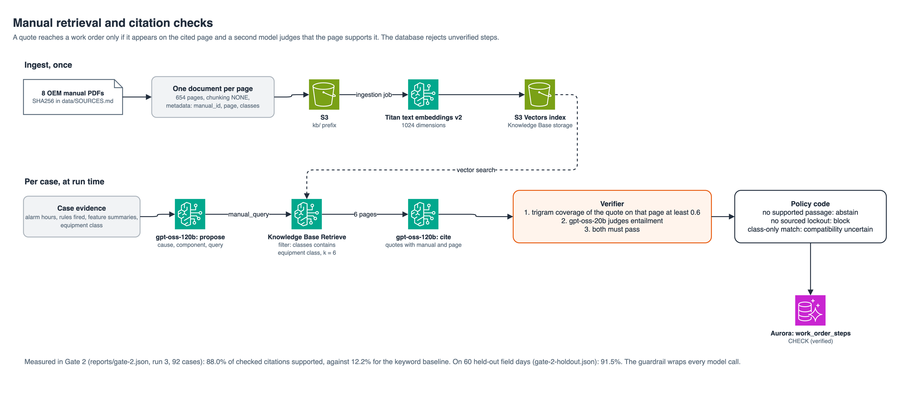](diagrams/knowledge-base.svg)

### 4. Network: private by default

Lambdas that touch Aurora run in one isolated subnet and reach AWS APIs through interface endpoints. Security groups allow only ports 443 and 5432 inside the VPC. Keeping the endpoints in one Availability Zone saves about $29 a month at list price; the trade-off is zone resilience.

[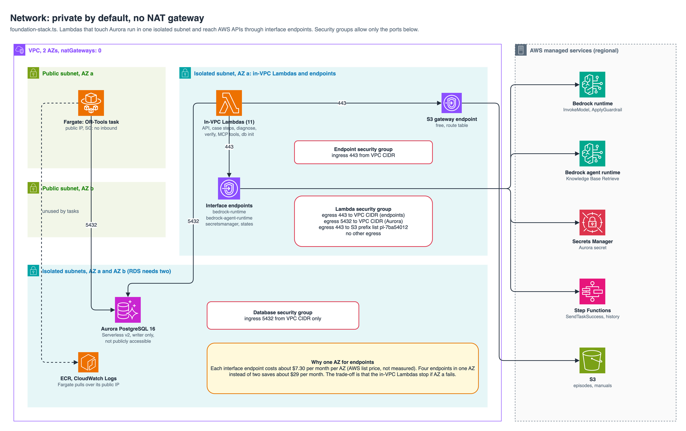](diagrams/network.svg)

### 5. Identity and least privilege

Cognito issues the identity, and both gateways verify it. Each Lambda has its own role scoped to named resources. The one wildcard is SendTaskSuccess and SendTaskFailure, because task tokens have no ARN.

[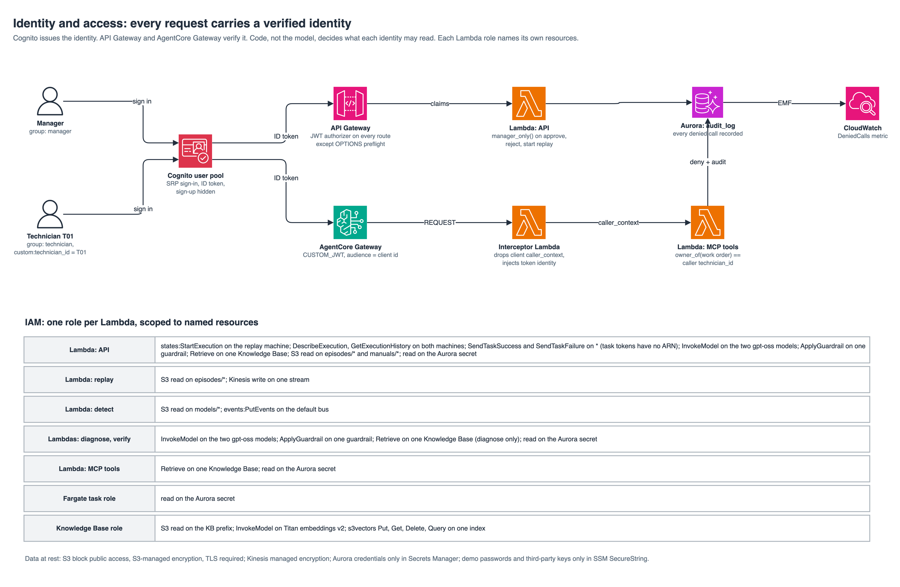](diagrams/security.svg)

### 6. A technician question over MCP

The gateway validates the token, and the interceptor replaces any identity the client sends. The tool checks ownership in Aurora, records the denial, and returns an error the assistant must report.

[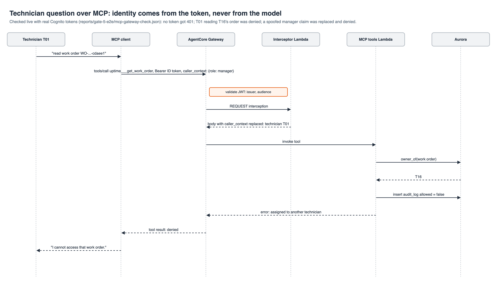](diagrams/mcp-sequence.svg)

### 7. Data model

Eleven tables hold assets, work orders, verified steps, dispatch decisions, pipeline runs, and the audit log. `work_order_steps.verified` carries a CHECK constraint, so the database itself refuses unverified steps.

[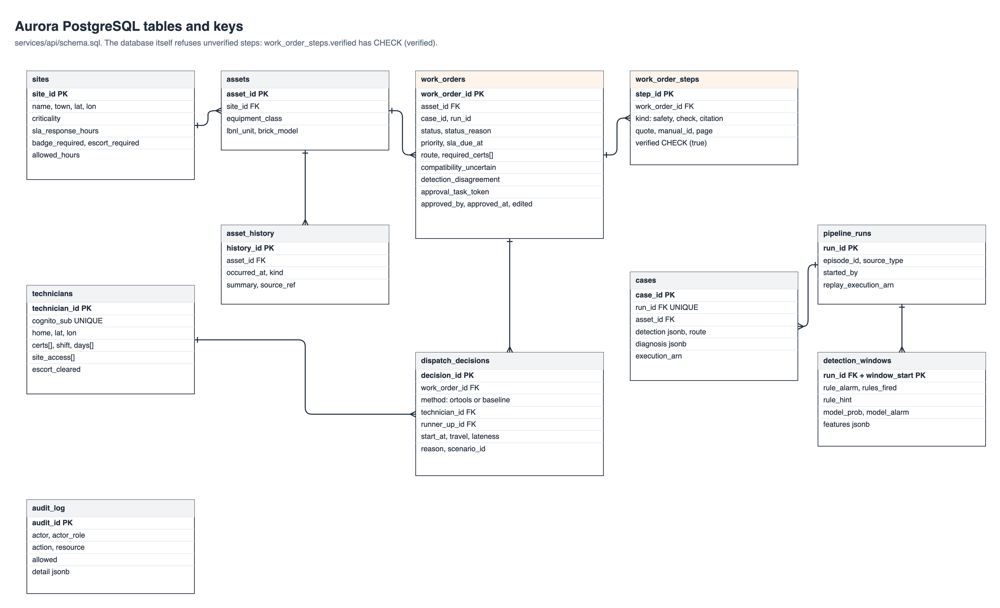](diagrams/data-model.svg)

### 8. Infrastructure as code and cost profiles

Two CDK stacks split always-on resources from demo-only resources, and each carries a cost-profile tag. Every deploy followed a posted `cdk diff`.

[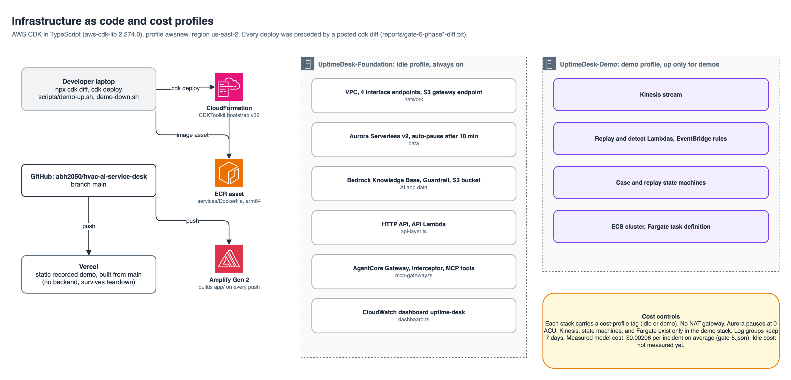](diagrams/deployment.svg)

### 9. Observability

Lambdas write CloudWatch embedded metric format lines, so cost per incident, stage latency, and denied calls reach the dashboard without a metrics agent.

[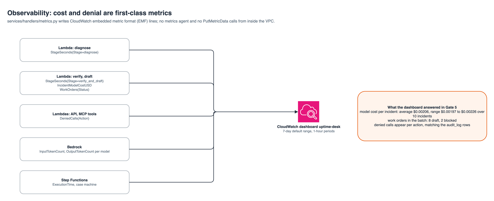](diagrams/observability.svg)

## Detailed results

### Gate 1: detection

The detector was measured against published LBNL ground-truth labels. Rules remain the primary detector because they win on the lab economizer and the field RTU. A disagreement between rules and the model goes to manager review.

| Test slice | XGBoost recall | Rules recall | Result |
|---|---:|---:|---|
| Lab AHU | **0.957** | 0.739 | Model wins |
| Lab economizer | 0.958 | **1.000** | Rules win |
| Field RTU | 0.187 | **0.648** | Rules win |

False alarms ranged from 0.5 to 1.9 events per unfaulted operating day. Source: measured results in [reports/gate-1.json](reports/gate-1.json).

### Gate 2: diagnosis and citation checks

Run 3 scored 92 cases. The AI result is compared with a keyword baseline for verified fault type, a rule hint for the proposed type, and keyword retrieval for citation support.

| Measured result | AI | Baseline |
|---|---:|---:|
| Verified fault type | **0.293** | 0.043 |
| Proposed fault type | **0.424** | 0.326 |
| Citation support | **0.880** | 0.122 |

The proposal difference was not statistically significant, with an exact McNemar p value of 0.078. On 60 unused field days, the frozen pipeline reached 0.750 verified fault-type accuracy and 0.915 citation support. Those days came from the same 2 field episodes, so they are not an episode-level holdout. Sources: measured results in [reports/gate-2.json](reports/gate-2.json), [reports/gate-2-stats.json](reports/gate-2-stats.json), and [reports/gate-2-holdout.json](reports/gate-2-holdout.json).

### Gate 3: work orders and dispatch

These are scenario model results for 37 jobs. The optimizer and both baselines used the same certifications, shifts, access rules, travel assumption, and SLA windows.

| Scenario method | Total lateness | Late jobs | Travel | Constraint violations |
|---|---:|---:|---:|---:|
| OR-Tools | **402 min** | **4** | 974 min | 0 |
| Nearest qualified | 1,343 min | 10 | **853 min** | 0 |
| Earliest available | **402 min** | **4** | 1,268 min | 0 |

Earliest available tied OR-Tools on lateness. Nearest qualified won on travel. OR-Tools produced the lowest weighted cost, and all 10 policy tests passed. Source: measured scenario results in [reports/gate-3.json](reports/gate-3.json).

### Gate 4: technician assistant

| Measured result | Value |
|---|---:|
| Written-question accuracy | 27 of 30, or 0.900 |
| Manual citation support | 28 of 29, or 0.966 |
| Adversarial tests | 12 of 12 |
| Unauthorized reads | 0 |
| Latency | p50 4.12 s, p95 9.05 s |
| Model cost | $0.00097 per question |

The weak slice was mixed questions, where only 1 of 3 passed because the model sometimes skipped a required job lookup. Source: measured results in [reports/gate-4.json](reports/gate-4.json).

### Gate 5: hosted system

| Measured result | Value |
|---|---:|
| Full flow | 8 of 10 runs passed |
| Replay start to work-order draft | median 39.4 s |
| Replay start to dispatch | median 77.3 s |
| Model cost per incident | average $0.00206 |
| Cross-technician data leaks | 0 |

Both failed runs were blocked because the case had no sourced lockout step. The average model cost covers diagnosis and entailment calls. Per-incident infrastructure cost was not isolated. Source: measured results in [reports/gate-5.json](reports/gate-5.json).


## Design choices and controls

### Safety and access controls

- API Gateway validates a Cognito JWT on every API route except CORS preflight.
- The AgentCore Gateway interceptor discards caller-supplied identity and inserts claims from the verified token.
- Each Lambda has its own IAM role scoped to named resources.
- A technician can read only assigned work orders and history for their assets.
- Every denied request enters `audit_log` and emits a CloudWatch metric.
- Each manual quotation must pass a literal page match and a second-model entailment check.
- `work_order_steps.verified` has a database check constraint, so unverified steps cannot be stored.
- The case machine blocks approval when no sourced lockout or disconnect step exists.
- A manager remains the only actor who can approve, edit, or reject a draft.


### Data and models

The project uses 123 Release 1 episodes from public LBNL datasets: 119 lab episodes and 4 field files from 2 Connecticut sites. Another 27 simulated files remain held for Release 2. Raw source files stay out of git. [data/SOURCES.md](data/SOURCES.md) records URLs, licenses, checksums, label conflicts, and manual compatibility.

| Task | Implementation |
|---|---|
| Detection | Deterministic HVAC rules plus local XGBoost |
| Diagnosis | `openai.gpt-oss-120b-1:0` on Amazon Bedrock |
| Entailment | `openai.gpt-oss-20b-1:0` on Amazon Bedrock |
| Retrieval | Bedrock Knowledge Bases, Titan Text Embeddings v2, S3 Vectors |
| Dispatch | OR-Tools CP-SAT in an ECS Fargate task |
| Assistant tools | MCP handlers behind AgentCore Gateway |
| Web console | React, TypeScript, Vite, and Amplify UI |
| Infrastructure | AWS CDK in TypeScript |

The manuals cover equipment classes, not the exact LBNL units. Every Release 1 diagnosis therefore carries a compatibility warning.


### Copilot Studio plan

Release 3 would expose selected API operations to a Microsoft Copilot Studio agent through a custom connector. The connector, its OAuth flow, and the agent have not been built. [docs/copilot.md](docs/copilot.md) records the proposed operations, identity boundary, and acceptance tests.


## Limitations

1. **Building operations faults go undetected by the diagnosis step.** The lab RTU.csv data has 11 operations fault cases, such as lighting schedule errors, setback errors, and infiltration. The AI proposed an equipment fault for all 11 and identified 0 of them (`reports/gate-2.json`, run 3, `operations_routing`). The pipeline still routes an operations proposal to operations review when no equipment rule fired. It never dispatches a technician for one.
2. **No manual covers the coil valves of the lab air handlers.** The public manual set has no hot water or chilled water coil valve service manual. The added Honeywell document covers the valve actuator only. Lab AHU diagnoses therefore abstain on 82.6% of cases and produce 0 verified answers (`reports/gate-2.json`, run 3, `by_family`).
3. **No manual matches any unit exactly.** LBNL does not name the makers of the AHUs or the field RTUs. Every manual is a class match, so every diagnosis carries "compatibility uncertain" (`data/SOURCES.md`).
4. **The AI's lead over the rule hint is not statistically significant.** In naming the fault, the AI scored 0.424 (95% CI 0.328 to 0.526) and the rule hint 0.326 (0.239 to 0.427). That gives 15 against 6 discordant cases and an exact McNemar p of 0.078 (`reports/gate-2-stats.json`). The AI's lead in verified diagnoses over the keyword baseline is significant (0.293 against 0.043, p < 0.0001).
5. **The diagnosis prompt was chosen after seeing test results.** Run 3 was selected after runs 1 and 2 were scored on the same cases. Every lab episode was used in those runs, so no lab holdout exists. The frozen run 3 pipeline was scored once on 60 unused days of the 2 field episodes (`reports/gate-2-holdout.json`). These are unused days, not unused episodes.
6. **Field data is small.** The field set has 2 faulted episodes, one per site. Field results rest on those 2 units.
7. **Detection raises too many false alarms for unattended use.** Gate 1 measured 0.5 to 1.9 alarm events per unfaulted operating day (`reports/gate-1.json`).
8. **The travel model is simple.** Dispatch uses straight-line distance at 40 km/h from each technician's home base, with no road network.


## What I would build next

- Add exact equipment manuals and coil-valve service documents, then rerun diagnosis on a new episode-level holdout.
- Train a separate router for building operations faults before any equipment diagnosis or technician dispatch.
- Add road travel times and live technician location constraints to dispatch evaluation.
- Improve mixed assistant questions so the agent always resolves the user's job before searching manuals.
- Complete the planned Copilot Studio connector and test user-delegated identity end to end.


## Run it yourself

### Public demo

Open [uptime-desk.vercel.app](https://uptime-desk.vercel.app). No sign-in is needed. The scenario launcher lists the recorded days, and **View recorded run** opens the one day that was run end to end: its pipeline stages, sensor trend, diagnosis and citations, work orders, dispatch board, and three recorded assistant answers. Every screen is a real API response captured from the live AWS system.

### Static demo locally

Use Node.js and npm. The build reads only committed snapshot files and gate reports.

```bash
cd app
npm ci
cd ..
scripts/build-static-demo.sh
cd app
npx vite preview --host 127.0.0.1 --port 4174 --outDir ../build/vercel/uptime-desk
```

In another shell, run the static smoke test.

```bash
cd app
BASE=http://127.0.0.1:4174 node e2e/static-smoke.mjs
```

### Python tests

The Python code requires Python 3.12. The database tests use PostgreSQL on port 54329. Tests that need raw or processed evaluation data require the files listed in [data/SOURCES.md](data/SOURCES.md).

```bash
uv sync
docker run --name uptime-pg \
  -e POSTGRES_PASSWORD=localtest \
  -e POSTGRES_DB=uptime \
  -p 54329:5432 \
  -d postgres:16
.venv/bin/python -m pytest -q tests
```

If the container already exists, start it with `docker start uptime-pg`.

### Frontend and infrastructure checks

```bash
cd app
npm ci
npm run lint
npm run build

cd ../infra
npm ci
npm run build
npx cdk synth --profile awsnew
npx cdk diff --profile awsnew
```

The CDK stacks target `us-east-2`. Review every diff before a deploy. The profile scripts in `scripts/` prompt before changing cloud resources. Do not run `scripts/demo-down.sh` while the hiring-manager demo week is active.

### Rebuild diagrams

```bash
python3 diagrams/build_diagrams.py
scripts/export-diagrams.sh
```

The export script requires the draw.io desktop CLI on `PATH`.


## Repository map

| Path | Purpose |
|---|---|
| `app/` | React console, Amplify auth, Playwright tests, static demo snapshot |
| `services/` | API, detection, diagnosis, citation checks, MCP tools, assistant |
| `pipelines/` | Data preparation, training, evaluation, deploy helpers |
| `infra/` | CDK stacks for foundation and demo profiles |
| `config/` | Sites, technicians, rules, policies, dispatch weights |
| `reports/` | Human and machine-readable gate evidence |
| `diagrams/` | Generated draw.io, PNG, and SVG architecture set |
| `docs/` | Showcase, source notes, and Release 3 plan |


## Builder

Built end to end by [Abhishek Shah](https://abh2050.github.io/abhishek-shah-portfolio/): data, models, AWS infrastructure, app, and evaluation. Source: [github.com/abh2050/hvac-ai-service-desk](https://github.com/abh2050/hvac-ai-service-desk).
